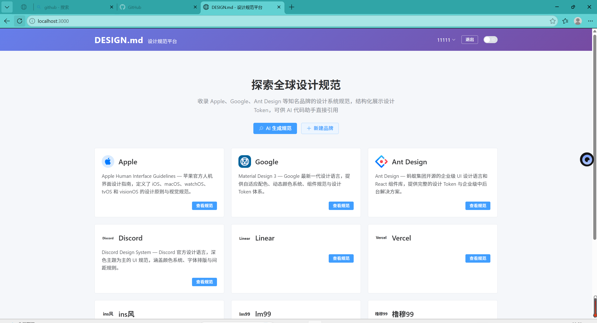
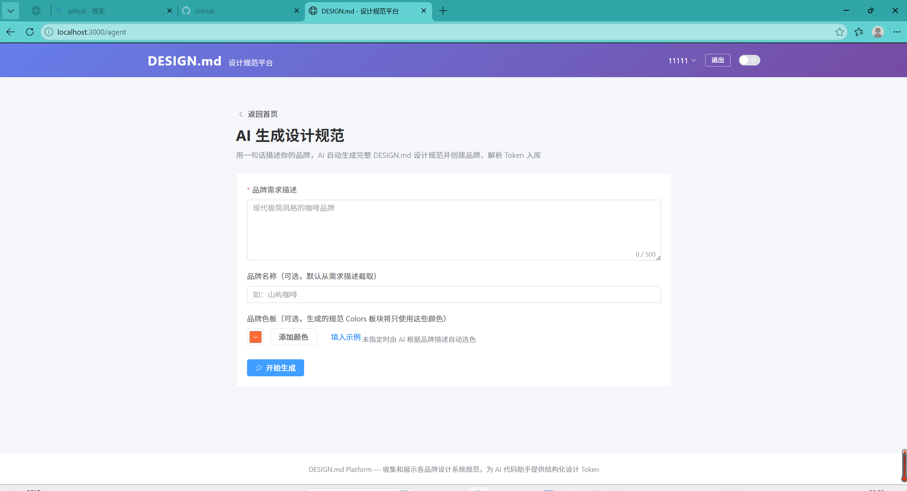
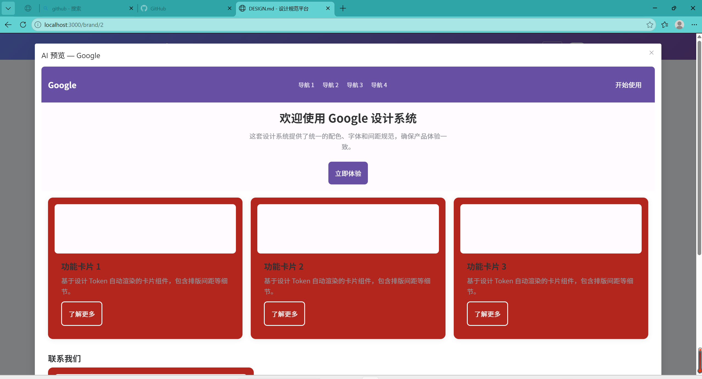
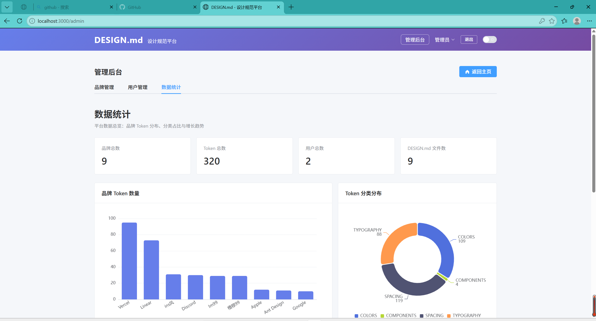

# DesignMD · AI 设计规范生成与管理平台

> 一个以 DESIGN.md 为唯一规范源的设计系统管理平台：AI一句话生成品牌设计规范，自动解析为结构化设计 Token，供页面与组件直接消费。

[](https://github.com/dai32607/design-md-platform/actions/workflows/ci.yml)
[](https://github.com/dai32607/design-md-platform/releases/tag/v1.0.0)

## 功能特性

- **AI 生成设计规范闭环**：输入一句品牌描述（可指定色板），Agent 自动完成「LLM 生成 DESIGN.md → 创建品牌 → 解析 Token → 入库」全流程
- **LLM 双模式客户端**：基于 OpenAI 兼容协议封装，配置 API Key 走真实大模型，未配置自动降级为 Mock 演示模式，开发与演示开箱即用
- **用户色板约束生成**：前端取色器采集 → 后端校验归一化 → 主色必用用户色值、不足自动以同色系明暗变体补齐，解决 LLM 颜色输出不可控问题
- **设计规范结构化解析**：解析 DESIGN.md 中 Colors / Typography / Spacing / Components 四大板块，生成标准化设计 Token
- **Token 驱动的 AI 预览**：品牌详情页基于真实 Token 动态渲染导航、Hero、卡片、表单等组件预览，所见即所得
- **三级权限模型**：预置品牌（system）只读 / 用户自建品牌（custom）创建者可查改删 / ADMIN 全量管理，前后端双层鉴权
- **文件与 Logo 管理**：DESIGN.md 上传解析、品牌 Logo 上传（安全校验扩展名与大小）

## 技术栈

| 层 | 技术 |
|---|---|
| 后端 | Java 21 · Spring Boot 3.2 · Spring Security + JWT · MyBatis-Plus · MySQL · springdoc-openapi（OpenAPI 3 / Swagger UI） |
| 前端 | Vue 3 · Vite 5 · Element Plus · Vue Router · ECharts |
| AI | OpenAI 兼容 Chat Completions（DeepSeek 等可无缝切换）+ Mock 降级 |

> 分层结构、认证与权限模型、设计 Token 数据模型、AI 生成闭环的实现细节见 [docs/architecture.md](docs/architecture.md)。

## API 文档（springdoc-openapi）

后端集成 springdoc-openapi（Spring Boot 3.2 兼容版 `springdoc-openapi-starter-webmvc-ui`），仅扫描 `/api/**` 接口路径：

| 入口 | 地址 |
|---|---|
| OpenAPI JSON | `http://localhost:8080/v3/api-docs` |
| Swagger UI | `http://localhost:8080/swagger-ui.html` |

演示包 / 本地开发已放行 `/v3/api-docs/**`、`/swagger-ui/**`、`/swagger-ui.html`（免登录即可访问，便于联调）；**生产环境部署时应改为鉴权后访问**，避免对外暴露接口结构。

## 离线演示包（免配置环境）

不想安装 JDK / Maven / Node 也能直接体验：下载离线演示包，解压即用。

- **内含**：前端与后端的编译产物，以及内置的精简 Java 运行时，无需另行安装 JDK、Maven 或 Node.js
- **使用**：解压后双击「启动演示.bat」，服务就绪后自动打开 `http://localhost:8080`（端口被占用时自动改用 8090），无需任何额外环境配置
- **演示账号**：账号名与初始密码随离线包内的《使用说明》（README.txt）一并提供，仓库与公开文档中不列明文密码
- **无 API Key 也能用**：未配置大模型 API Key 时，AI 生成设计规范功能自动降级为内置演示快照，全流程依然可以完整体验
- **下载**：[DesignMD-Demo.zip](https://github.com/dai32607/design-md-platform/releases/download/v1.0.0/DesignMD-Demo.zip)

## 快速启动

### 1. 初始化数据库

```sql
CREATE DATABASE design_db DEFAULT CHARACTER SET utf8mb4;
```

首次启动自动执行 schema.sql 建表；或手动导入 `backend/schema.sql`。

### 2. 启动后端（端口 8080）

```bash
cd backend
mvn spring-boot:run          # 要求 JDK 21（编译目标 21）
```

数据库连接配置在 `backend/src/main/resources/application.yml`，默认连接 `jdbc:mysql://localhost:3306/design_db`；账号密码以占位符形式读取环境变量，仓库内不包含任何真实凭据：

```yaml
username: ${MYSQL_USERNAME:root}
password: ${MYSQL_PASSWORD:}
```

**启动前必须先设置 `MYSQL_USERNAME` 与 `MYSQL_PASSWORD`**：仓库不提供任何数据库默认凭据，未注入环境变量时连接会直接失败（也可在 `application.yml` 中自行覆盖为本地占位配置）：

```powershell
# Windows PowerShell（当前终端会话生效）
$env:MYSQL_USERNAME = "root"
$env:MYSQL_PASSWORD = "<你的 MySQL 密码>"
```

```bash
# macOS / Linux
export MYSQL_USERNAME=root
export MYSQL_PASSWORD='<你的 MySQL 密码>'
```

设置后在同一终端会话内执行 `mvn spring-boot:run`；若在 IDE 中启动，请在运行配置的环境变量（Environment variables）中填写这两个变量。

### 3. 启动前端（端口 3000）

```bash
cd frontend
npm install
npm run dev                  # 访问 http://localhost:3000
```

> 前端已配置 Vite 代理，`/api` 与 `/uploads` 请求自动转发至 `http://localhost:8080`。

### 4. 演示账号

演示库初始化时内置两个账号（见下表）。**初始密码不随公开仓库与文档分发**，仅在离线演示包内的《使用说明》（README.txt）中提供；数据库中密码以 BCrypt 哈希形式存放，仓库不包含任何明文密码。

| 账号 | 角色 |
|---|---|
| admin | ADMIN（管理后台 / 全量权限） |
| test | USER（可自建品牌并上传规范） |

> 本地演示建议自行注册普通账号体验（可浏览 system 预置品牌）；如需管理员权限，请使用离线包内《使用说明》提供的初始密码登录后立即重置。任何非本地环境部署前，请务必更换管理员密码与 `JWT_SECRET`。

## 核心模块

```
backend/src/main/java/com/designmd/platform
├── controller        # REST 接口层（品牌 / 用户 / Token / AI Agent / 统计）
├── service           # 业务逻辑（品牌创建/修改/删除、解析入库、Agent 编排）
├── config            # Security 鉴权 / LlmClient / Cors / 上传路径解析
├── entity + mapper   # 数据实体与 MyBatis-Plus 映射
└── common            # 统一响应 Result / 全局异常 / 分页

frontend/src
├── views             # Home / BrandDetail / AgentGenerate / Upload / Admin / Dashboard 等
├── api/index.js      # Axios 接口封装（含 JWT 拦截器）
└── router            # 路由与登录守卫
```

## 权限设计

| 操作 | system 品牌（预置） | custom 品牌（自建） | ADMIN |
|---|---|---|---|
| 查看 | 公开 | 公开 | 可看全部 |
| 修改 / 删除 | 禁止 | 仅创建者本人 | 可操作 |
| 管理后台 / 用户管理 / 统计 | - | - | 仅 ADMIN |

接口层由 Spring Security 统一校验（`/api/admin/**` 要求 ROLE_ADMIN），页面按钮按用户角色/品牌归属动态显隐。

## AI 生成闭环（项目亮点）

```
一句话描述 + 可选色板
        │
        ▼
AgentController ──► AgentService
                        ├─ ① 组装 Prompt（OpenAI 兼容）
                        ├─ ② LlmClient 生成 DESIGN.md（Mock / 真实大模型）
                        ├─ ③ 复用 BrandService 创建自定义品牌
                        ├─ ④ DesignFileService 保存规范文件
                        └─ ⑤ DesignTokenService 解析 Token 入库
```

LLM 配置（`application.yml`）：

```yaml
llm:
  base-url: https://api.deepseek.com   # OpenAI 兼容地址
  api-key: ""                          # 留空 = Mock 演示模式
  model: deepseek-chat
```

## 数据库表

- `user`：账号体系（角色 USER / ADMIN）
- `brand`：品牌（source=system/custom，creator_id 记录创建者）
- `design_file`：DESIGN.md 规范文件
- `design_token`：结构化设计 Token（category: COLORS / TYPOGRAPHY / SPACING / COMPONENTS）

## 界面一览









## 作者

- 作者 GitHub 主页：<https://github.com/dai32607>
