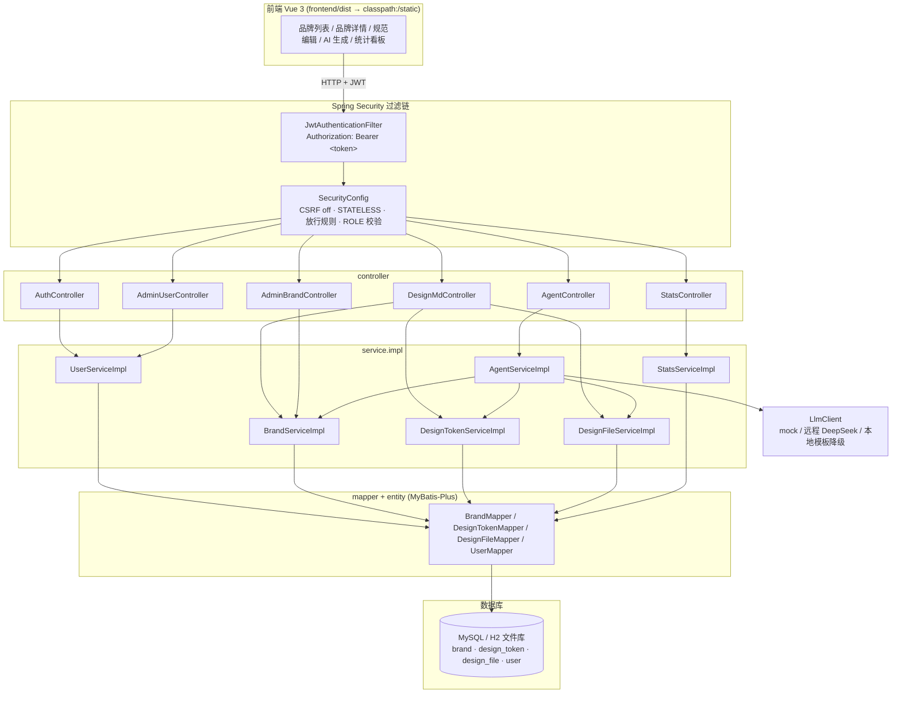
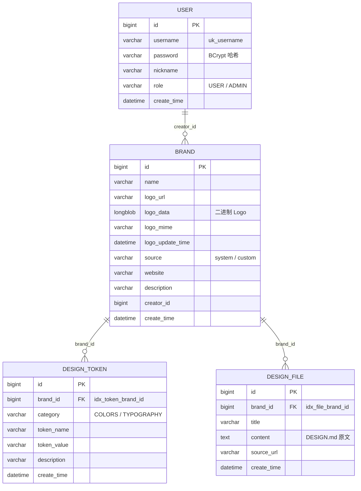
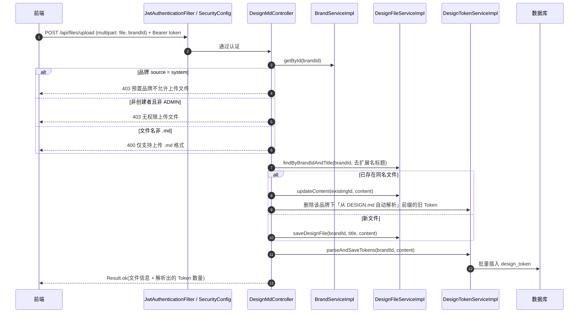
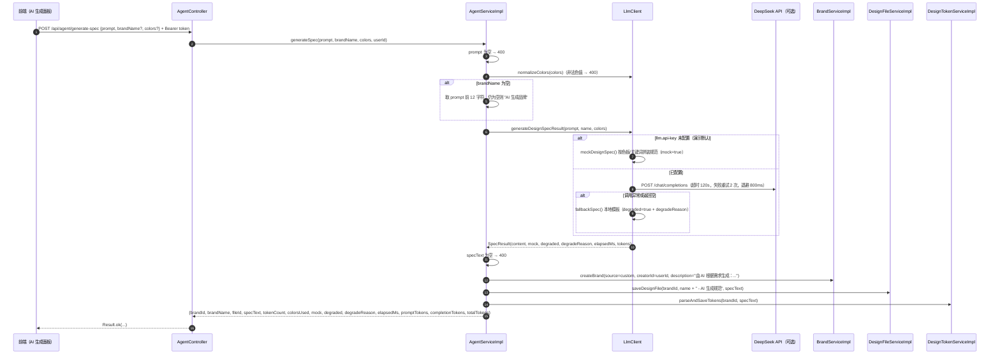
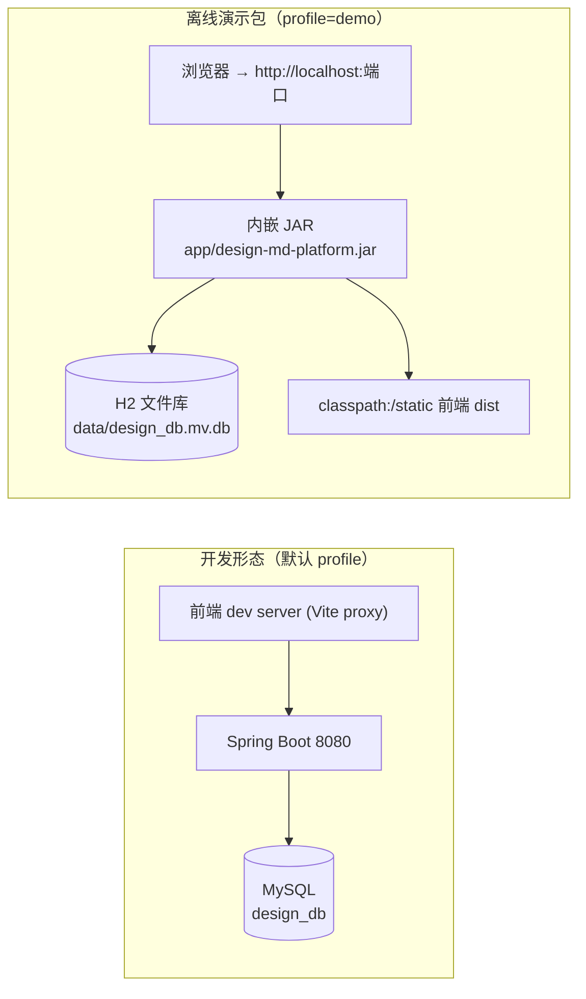

# DesignMD 架构说明

本文档描述 DesignMD（design-md-platform）当前代码的真实分层、认证模型、数据模型、AI 生成闭环与部署形态。所有内容均以仓库内源码与配置为准（`backend/src/main/java/com/designmd/platform`、`backend/src/main/resources`、`frontend/src`），不含未实现的设计设想。

---

## 1. 系统概览

DesignMD 是一个「品牌设计规范（DESIGN.md）」管理平台：以品牌（Brand）为聚合根，保存设计规范文档（DesignFile），并从文档中自动抽取出结构化设计 Token（DesignToken，颜色与字体）；同时提供一句话 AI 生成整套规范的闭环能力，以及后台统计、用户与品牌管理。

| 层次 | 技术选型 | 说明 |
|---|---|---|
| 前端 | Vue 3 + Vite + Element Plus + ECharts | `frontend/src`，构建产物 `frontend/dist`，打包时并入后端 `classpath:/static/` |
| 后端 | Spring Boot 3.2.0 / Java 17 | `com.designmd.platform` |
| 持久层 | MyBatis-Plus 3.5.5 | `mapper` + `entity`，分页插件 `PaginationInnerInterceptor` |
| 数据库 | MySQL（默认）/ H2 文件库（离线演示） | 两套 profile：`application.yml` / `application-demo.yml` |
| 认证 | Spring Security + JWT（jjwt 0.11.5，HS256） | 无状态会话，`JwtAuthenticationFilter` |
| AI | DeepSeek（OpenAI 兼容 `/chat/completions`） | `LlmClient`，未配置 Key 时自动 mock；调用失败降级本地模板 |
| 接口文档 | springdoc-openapi 2.4.0 | `/v3/api-docs`、`/swagger-ui/index.html` |

---

## 2. 分层结构

```
backend/src/main/java/com/designmd/platform
├── DesignMdApplication.java
├── controller/              # 接口层：参数接收与校验、权限判定、Result 包装
│   ├── AuthController       # /api/auth：register / login / me / account(DELETE)
│   ├── DesignMdController   # /api：brands、tokens、files、logo
│   ├── AgentController      # /api/agent/generate-spec
│   ├── AdminBrandController # /api/admin/brands
│   ├── AdminUserController  # /api/admin/users
│   └── StatsController      # /api/stats：overview / brand-tokens / category-dist / trend
├── service/                 # 业务接口（6 个）
│   ├── UserService / BrandService / DesignTokenService
│   ├── DesignFileService / AgentService / StatsService
│   └── impl/                # 实现类（6 个，含事务边界与解析规则）
├── mapper/                  # MyBatis-Plus BaseMapper（BrandMapper / DesignTokenMapper / DesignFileMapper / UserMapper）
├── entity/                  # 表映射实体：Brand / DesignToken / DesignFile / User
├── config/
│   ├── SecurityConfig       # 过滤链、放行规则、角色校验、401/403 JSON 响应、BCryptPasswordEncoder
│   ├── JwtAuthenticationFilter # Bearer Token → SecurityContext
│   ├── LlmClient            # AI 调用（mock / 远程 / 降级）
│   ├── MybatisPlusConfig    # @MapperScan、分页插件、createTime 自动填充
│   ├── WebMvcConfig         # SPA history 路由回退到 index.html
│   └── CorsConfig
├── common/                  # Result / PageResult / BizException / GlobalExceptionHandler
├── util/JwtUtil             # 生成与解析 token
└── demo/H2CompatFunctions   # H2 自定义函数 DATE_FORMAT（演示库兼容 MySQL 函数）
```

分层约束：

- **controller** 只做参数接收、格式校验、权限判定（如「预置品牌不允许上传文件」「非创建者且非 ADMIN 拒绝」）与 `Result` 包装；业务规则落在 service。
- **service** 承载事务（`@Transactional(rollbackFor = Exception.class)`）、解析规则（Token 抽取）、聚合逻辑（品牌详情）。
- **mapper** 仅数据访问，不写业务判断；复杂查询通过 `LambdaQueryWrapper` / `QueryWrapper` 构造。
- 异常统一由 `GlobalExceptionHandler` 转成 `Result`，`BizException` 携带业务错误码。

---

## 3. 架构图



---

## 4. 认证与权限模型

### 4.1 会话与令牌

- **无状态**：`SessionCreationPolicy.STATELESS` + 关闭 CSRF，身份完全依赖 JWT。
- **签发**：`UserServiceImpl.login` 校验用户名与 BCrypt 密码后，由 `JwtUtil.generateToken(userId, username, role)` 生成 HS256 token，载荷含 `sub`（用户名）、`userId`、`role`、`iat`、`exp`。有效期取 `app.jwt.expiration`（默认 86,400,000ms = 24h），密钥取 `app.jwt.secret`（配置项 `${JWT_SECRET:...}`，生产必须通过环境变量覆盖）。
- **校验**：`JwtAuthenticationFilter`（`OncePerRequestFilter`）从 `Authorization: Bearer <token>` 取令牌，`JwtUtil.parseToken` 解析成功则把 `userId/role` 注入 `SecurityContext` 的 `UsernamePasswordAuthenticationToken`，权限为 `ROLE_{role}`；解析失败返回 `null` 并继续链（后续被拒绝）。
- **密码存储**：`BCryptPasswordEncoder`，数据库只存哈希；登录失败统一返回错误提示，不区分「用户不存在」与「密码错误」。

### 4.2 放行与角色规则（`SecurityConfig` 实际顺序）

| 顺序 | 匹配 | 规则 |
|---|---|---|
| 1 | `DELETE /api/auth/account` | 需登录（注销当前账号） |
| 2 | `/api/auth/**` | 放行（注册/登录） |
| 3 | `GET /api/brands/**`、`GET /api/tokens/**`、`GET /api/files/**` | 放行（浏览与详情公开） |
| 4 | `/uploads/**` | 放行（静态资源） |
| 5 | `/v3/api-docs/**`、`/swagger-ui/**`、`/swagger-ui.html` | 放行（接口文档，生产建议加鉴权） |
| 6 | `/api/stats/**`、`/api/admin/**` | 需 `ROLE_ADMIN` |
| 7 | 其余 `/api/**` | 需登录 |
| 8 | 非 `/api` 路径 | 放行（前端静态资源与 SPA 路由） |

未认证返回 JSON `401`，权限不足返回 JSON `403`（`authenticationEntryPoint` / `accessDeniedHandler` 均用 `ObjectMapper` 写出 `Result`）。

### 4.3 数据级权限（资源归属）

角色只有两级：`USER`（`user.role` 默认值）与 `ADMIN`。除角色外，controller 对写操作再做「归属校验」：

| 操作 | 规则（源码实现） |
|---|---|
| 上传 DESIGN.md（`POST /api/files/upload`） | `source = system` 的预置品牌一律拒绝（403「预置品牌不允许上传文件」）；非 ADMIN 且 `brand.creatorId != 当前用户` 拒绝（403） |
| 品牌 Logo 上传（`POST /api/brands/{id}/logo`） | 同上归属校验 |
| 删除账号（`DELETE /api/auth/account`） | 需登录，仅作用于当前 token 对应用户 |

品牌列表支持 `mine=true` 只查当前用户创建的品牌（`wrapper.eq(Brand::getCreatorId, userId)`），关键字检索对 `name` / `description` 做 `LIKE`，并对 `\ % _` 做转义（`escapeLikeKeyword`）。

---

## 5. 设计 Token 数据模型

### 5.1 实体关系



关系要点（对应 `db-h2/schema.sql` 与实体注解）：

- `design_token.brand_id`、`design_file.brand_id` 均建有单列索引（`idx_token_brand_id`、`idx_file_brand_id`），`design_token` 另有 `idx_token_brand_category` 支撑按类别查询；
- `user.username` 唯一（`uk_username`）；
- 品牌删除为**级联清理**：`BrandServiceImpl.deleteBrand` 在一个事务里先删该品牌的 token 与 file，再删品牌本体（非数据库外键级联）；
- Logo 双通道存储：既可用外链 `logo_url`，也可把二进制存 `logo_data` + `logo_mime`，由 `GET /api/brands/{id}/logo` 以图片流返回，保证离线演示不破图；一旦 `logo_data` 非空，`updateBrand` 不再接受手工修改 `logo_url`。

### 5.2 Token 抽取规则（`DesignTokenServiceImpl.parseAndSaveTokens`）

Token 不是手工录入的，而是从 DESIGN.md 文本正则抽取，`category` 仅两种取值：

| 类别 | 抽取目标 | 正则（实际实现） | token_name 生成 |
|---|---|---|---|
| `COLORS` | 十六进制色值 | `#([0-9a-fA-F]{3}|[0-9a-fA-F]{6})\b`，统一转大写 | `Parsed Color {n}` |
| `TYPOGRAPHY` | 字号 | `[Ff]ont[-\s]?[Ss]ize:\s*([^;\n]+)` | `Font Size {n}` |
| `TYPOGRAPHY` | 字体族 | `[Ff]ont[-\s]?[Ff]amily:\s*([^;\n]+)` | `Font Family {n}` |
| `TYPOGRAPHY` | 行高 | `[Ll]ine[-\s]?[Hh]eight:\s*([^;\n]+)` | `Line Height {n}` |

去重规则：以 `类别:值` 为键的 `Set` 去重，同一色值/字号在文档中重复出现只入库一条；`description` 统一前缀「从 DESIGN.md 自动解析」，该前缀同时是「同名文件重新上传时清理旧 Token」的判定依据。

---

## 6. 核心链路

### 6.1 DESIGN.md 上传与解析（同步链路）



同一套 Token 解析逻辑被三处复用：上传解析、AI 生成闭环、以及（前端）手工保存后的重解析，避免出现两套不一致的抽取规则。

### 6.2 AI 生成闭环（当前为 demo 阶段，mock 实现）



**如实说明当前阶段**：`LlmClient.isMockMode()` 的判定是「`llm.api-key` 为空即 mock」。离线演示包（`application-demo.yml`）中 `llm.api-key` 显式为空字符串，因此**演示环境下的 AI 生成是本地模板 mock 实现，不调用任何大模型**，返回体里以 `mock=true` 明示；只有显式配置 `DEEPSEEK_API_KEY` 后才走真实远程调用。整段闭环标记 `@Transactional(rollbackFor = Exception.class)`：品牌、规范文件、Token 三步要么全部入库，要么全部回滚，不会留下「有品牌无规范」的脏数据。

### 6.3 统计看板（只读聚合）

`StatsController` 四个接口均要求 `ROLE_ADMIN`：

| 接口 | 聚合方式 |
|---|---|
| `GET /api/stats/overview` | 四张表 `selectCount` → `brandCount / tokenCount / userCount / fileCount` |
| `GET /api/stats/brand-tokens` | `design_token` 按 `brand_id` 分组计数，再回填品牌名（缺名回退 `未知品牌(#id)`） |
| `GET /api/stats/category-dist` | 按 `category` 统计 Token 分布（前端饼图） |
| `GET /api/stats/trend` | 按日期维度聚合（`DATE_FORMAT`，H2 环境由 `H2CompatFunctions` 提供同名函数） |

---

## 7. 接口清单

| 方法 | 路径 | 认证 | 说明 |
|---|---|---|---|
| POST | `/api/auth/register` | 放行 | 注册（默认 `role=USER`） |
| POST | `/api/auth/login` | 放行 | 登录，返回 JWT |
| GET | `/api/auth/me` | 登录 | 当前用户信息 |
| DELETE | `/api/auth/account` | 登录 | 注销当前账号 |
| GET | `/api/brands` | 放行 | 品牌分页（`page/pageSize/keyword/source/mine`） |
| GET | `/api/brands/{id}` | 放行 | 品牌详情（含 Token 分组与文件列表聚合） |
| POST | `/api/brands` | 登录 | 新建品牌 |
| PUT | `/api/brands/{id}` | 登录 | 更新品牌 |
| DELETE | `/api/brands/{id}` | 登录 | 删除品牌（级联删 token / file） |
| GET | `/api/brands/{brandId}/tokens` | 放行 | 品牌 Token 列表 |
| GET | `/api/brands/{brandId}/token-categories` | 放行 | 品牌 Token 类别 |
| PUT | `/api/tokens/{id}` | 登录 | 修改 Token |
| DELETE | `/api/tokens/{id}` | 登录 | 删除 Token |
| GET | `/api/brands/{brandId}/files` | 放行 | 规范文件列表 |
| GET | `/api/files/{id}` | 放行 | 规范文件详情 |
| POST | `/api/files/upload` | 登录 + 归属 | 上传 .md 并解析 Token |
| POST | `/api/brands/{id}/logo` | 登录 + 归属 | 上传 Logo（二进制入库） |
| GET | `/api/brands/{id}/logo` | 放行 | 读取 Logo 图片流 |
| POST | `/api/agent/generate-spec` | 登录 | AI 一句话生成整套规范 |
| POST | `/api/admin/brands` | ADMIN | 新增预置品牌 |
| PUT | `/api/admin/brands/{id}` | ADMIN | 修改预置品牌 |
| DELETE | `/api/admin/brands/{id}` | ADMIN | 删除预置品牌 |
| GET | `/api/admin/users` | ADMIN | 用户列表 |
| PUT | `/api/admin/users/{id}/password` | ADMIN | 重置用户密码 |
| DELETE | `/api/admin/users/{id}` | ADMIN | 删除用户 |
| GET | `/api/stats/overview` 等 4 个 | ADMIN | 统计看板数据 |

统一响应包装：`Result{code, message, data}`；分页为 `PageResult{total, records}`；异常经 `GlobalExceptionHandler` 输出（`BizException` 保留业务码，参数校验错误 400，未预期异常 500）。

---

## 8. 部署形态与双数据源



- **profile 切换**：默认 `application.yml` 走 MySQL（`app.db-type=mysql`，分页插件按 MySQL 方言）；`application-demo.yml` 走 H2 文件库（`jdbc:h2:file:./data/design_db;NON_KEYWORDS=USER;AUTO_SERVER=TRUE`，`sa` 空密码，仅用于本机演示），并将 JPA/日志级别降到 `warn`/`info` 减少噪声。
- **H2 兼容层**：`CREATE ALIAS DATE_FORMAT FOR 'com.designmd.platform.demo.H2CompatFunctions.dateFormat'` 让统计 SQL 里的 MySQL 函数在 H2 下可用；`NON_KEYWORDS=USER` 解决 `user` 表名与 H2 关键字冲突。
- **SPA 同源托管**：`WebMvcConfig` 把 `/**` 映射到 `classpath:/static/`，对 `api/`、`uploads/`、`actuator/` 前缀不做回退，其余未命中路径回退 `index.html`，支持 `/brand/29` 这类 history 路由直刷。
- **配置文件中的密钥口径**：`app.jwt.secret` 取 `${JWT_SECRET:默认值}`、`llm.api-key` 取 `${DEEPSEEK_API_KEY:}`，仓库不保存真实凭据；演示包的 H2 初始账号密码哈希亦不写入文档，由仓库所有者线下保管。

---

## 9. 测试与持续集成

- **测试分层**（`backend/src/test/java/com/designmd/platform`）：
  - 单元测试：`service/*ServiceImplTest`（Brand / DesignToken / User / Agent）、`util/JwtUtilTest`、`config/LlmClientTest`（含 mock 模式、色值归一化、降级路径）；
  - 切片测试：`web/*SliceTest`（`AuthControllerSliceTest`、`DesignMdControllerSliceTest`、`AgentControllerSliceTest`、`AdminAndStatsSliceTest`、`UncoveredEndpointsSliceTest`），以 `@WebMvcTest` + MockMvc 覆盖接口层与安全规则。
- **CI**：`.github/workflows/ci.yml` 分 backend / frontend 两个 job；backend 使用 Temurin JDK 21 + Maven 缓存执行测试，frontend 使用 Node 24 执行 `npm ci` 与 `npm test`。
- **覆盖率**：后端集成 JaCoCo（`jacoco-maven-plugin`），`mvn test` 后生成 `backend/target/site/jacoco/index.html`，CI 通过 `actions/upload-artifact@v4` 上传 `backend/target/site/jacoco/` 作为构建产物。

---

## 10. 已知边界

- AI 生成为 demo 阶段能力：未配置 `DEEPSEEK_API_KEY` 时使用本地模板 mock（返回 `mock=true`），配置后才有真实大模型输出；远程失败时降级为模板（`degraded=true`），保证接口不返回 500。
- Token 抽取是正则启发式：只识别十六进制色值与 `font-size/font-family/line-height` 三类字体属性，不解析间距、圆角、阴影等其他设计变量。
- 角色仅 `USER` / `ADMIN` 两级；公开查询接口（品牌、Token、文件详情）无需登录，属演示便利设计，生产应按需收紧。
- H2 profile 仅面向本机离线演示（单进程、`AUTO_SERVER=TRUE`），不适用于多实例部署。

---

## 11. 文档维护说明

本文档与源码同步维护：修改分层、放行规则、Token 抽取正则、AI 闭环步骤、表结构或配置项时，应同步更新本文对应章节与 Mermaid 图。
